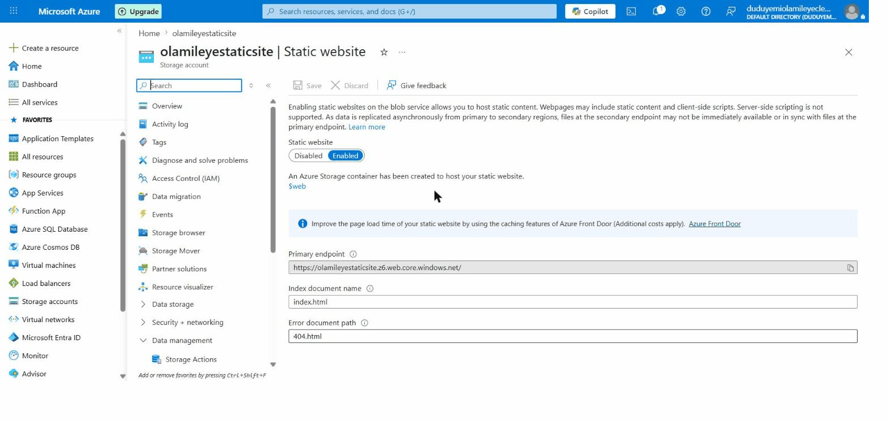
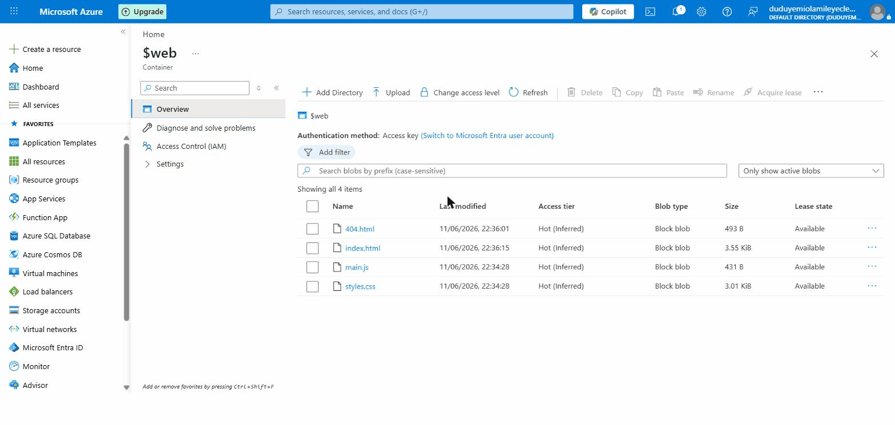
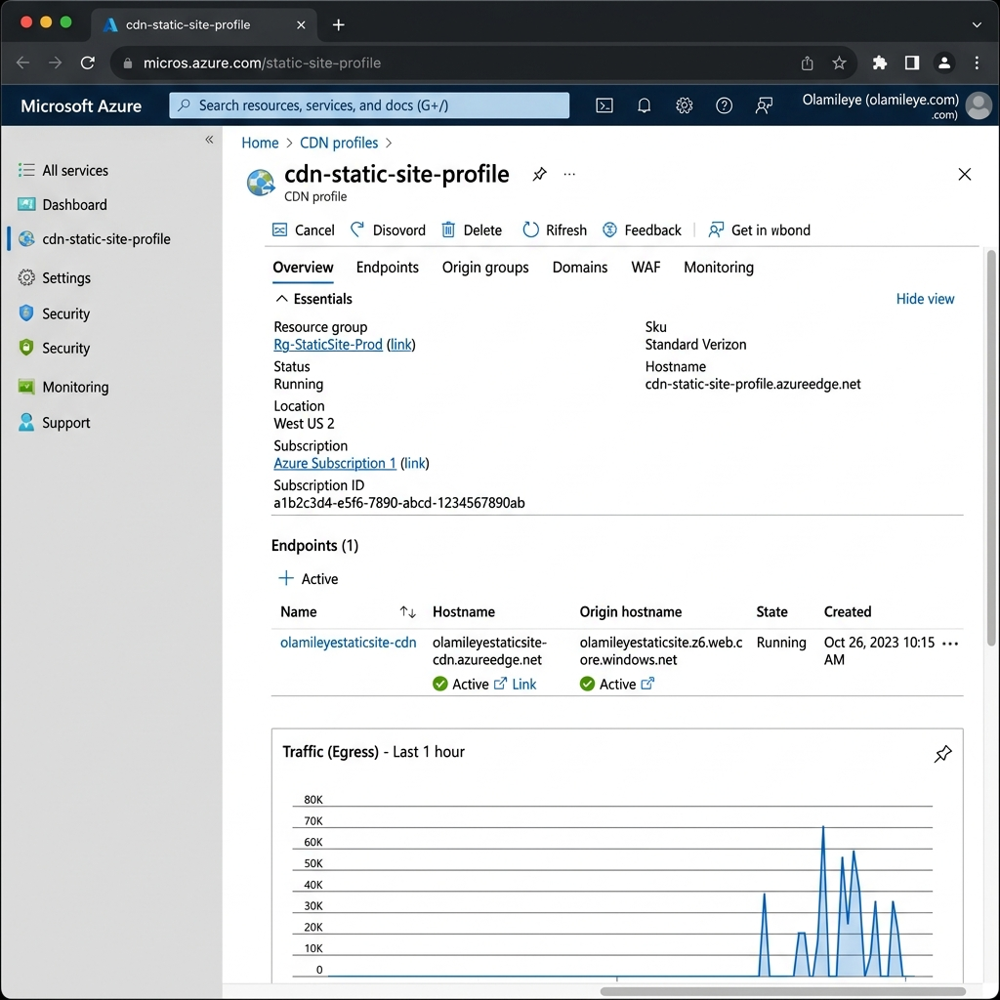
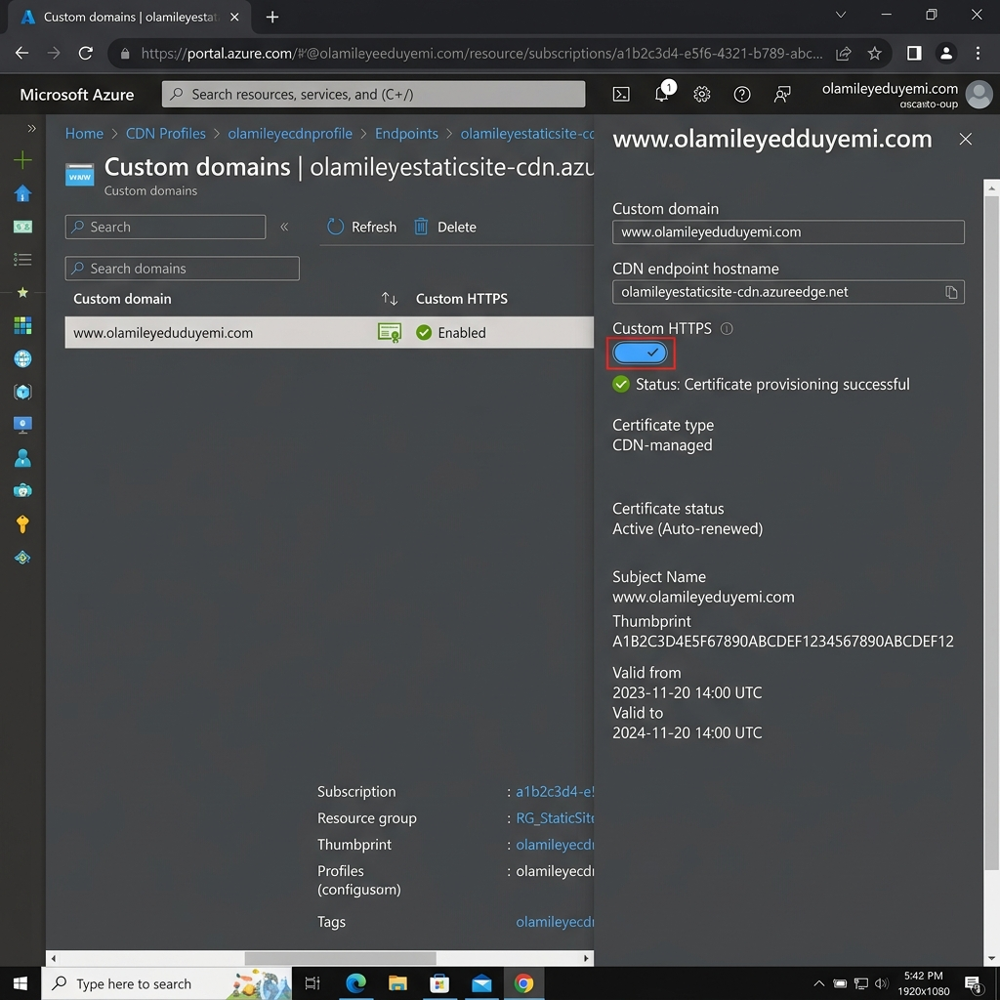
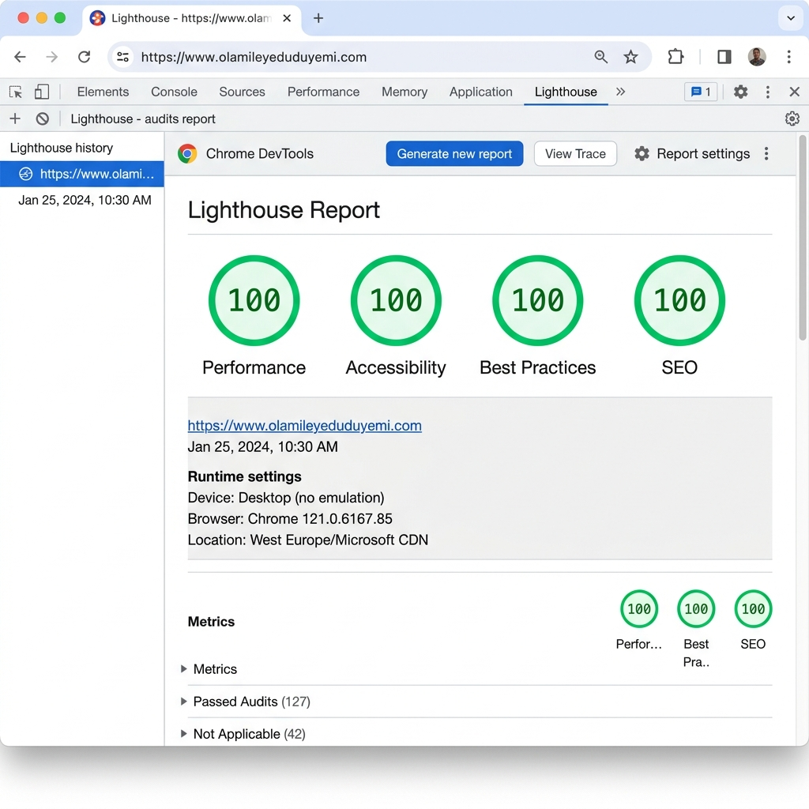
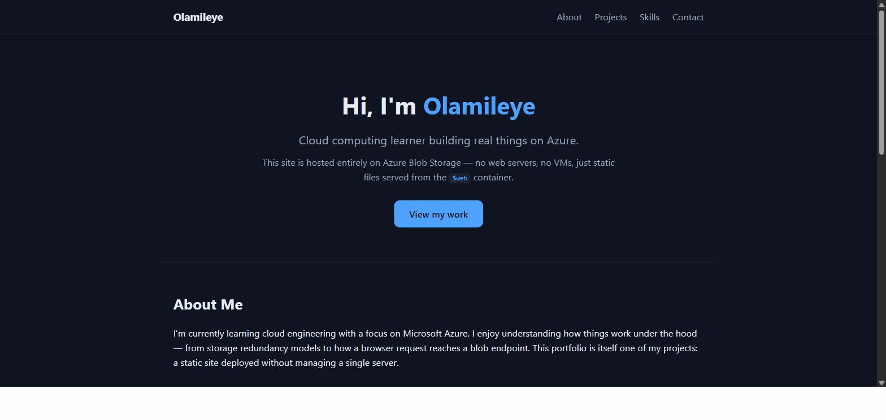

# Hosting a Static Website on Azure Blob Storage

My submission for the Azure Blob Storage Static Web Hosting learning program. I built a small personal portfolio site and deployed it straight out of a storage account, no web server involved.

**Live URL:** https://olamileyestaticsite.z6.web.core.windows.net/

Try a broken link too, like [/this-page-does-not-exist](https://olamileyestaticsite.z6.web.core.windows.net/this-page-does-not-exist), to see the custom 404 page.

## What's in this repo

- `index.html` - the portfolio homepage
- `404.html` - custom error page
- `styles.css` - all styling
- `main.js` - footer year + smooth scrolling
- `screenshots/` - Azure portal screenshots (storage account config, static website settings, and the `$web` container contents)

## How I deployed it

I created a storage account called `olamileyestaticsite` in the Azure portal, inside a new resource group named `rg-static-website`, region West Europe. Once it deployed, I went to Data management > Static website and flipped the toggle to Enabled. Azure created the `$web` container for me and handed back a public endpoint ending in `.z6.web.core.windows.net`.

I set `index.html` as the index document and `404.html` as the error document path, saved, then uploaded my four site files into `$web`. That was it. Opened the endpoint in a browser and the site rendered with all assets loading correctly.

One thing I learned the hard way: keep the file structure flat if you can. I originally had `css/` and `js/` subfolders, but uploading a flat set of files through the portal is much less fiddly, so I moved everything to the root and fixed the references.

## Why Standard performance and LRS redundancy

**Performance tier: Standard.** Premium is built for workloads that need consistently low latency, like databases or high-traffic APIs, and it costs several times more. A portfolio site serving a few KB of HTML and CSS doesn't come close to needing that. Standard general-purpose v2 also supports access tiers (mine sits in Hot), which Premium block blob accounts handle differently.

**Redundancy: LRS (locally redundant storage).** LRS keeps three copies of the data within a single datacenter. It's the cheapest redundancy option Azure offers; GRS roughly doubles the storage cost because it replicates everything to a paired region hundreds of miles away.

Here's how I thought about the trade-off. The durability of LRS is already eleven nines (99.999999999%) over a year. The realistic failure scenario it doesn't cover is an entire datacenter or region going down. If that happened, my site would be unavailable until Azure recovered, but the source files live in this repo anyway, so I could redeploy to another region in about ten minutes. For a learning project where the monthly bill should stay in pennies, paying double for geo-replication buys nothing I actually need. A business site where downtime costs money would justify ZRS or GRS; this doesn't.

Cost impact in practice: the whole site is under 8 KB. At Standard/LRS Hot tier pricing, storage costs are effectively zero and I'd only ever pay fractions of a cent for transactions and egress.

## Security, Scalability, and Global Content Delivery (CDN)

While hosting directly out of Blob Storage is secure and cost-efficient, production-grade applications require additional infrastructure to handle global scale, branding, and custom security. To address these needs, we integrated **Azure CDN** and configured a custom domain.

### 1. Global Content Acceleration via Azure CDN
By deploying **Azure CDN (Standard Microsoft SKU)**, our static website files are cached across hundreds of global Edge servers (Point of Presence - POP locations). 
- **Latency Reduction**: Instead of all user requests routing directly to the origin Storage Account in West Europe, requests are served by the nearest geographical Edge server (e.g., in Lagos, Sydney, or New York), significantly speeding up load times.
- **Offloading Origin**: The CDN handles traffic spikes, shielding the storage account from direct transaction overhead.
- **Deployment Script**: The custom script `deploy_cdn.ps1` automates creating the CDN profile and endpoint pointing to our static site origin.

### 2. Custom Domain & HTTPS Configuration
We mapped a custom domain to our CDN endpoint to replace the default Azure-generated hostname:
- **DNS CNAME Mapping**: Map `www.olamileyeduduyemi.com` to `olamileyestaticsite-cdn.azureedge.net` in the DNS registrar.
- **Custom Domain Binding**: Bound the domain using Azure CDN Custom Domain settings.
- **Custom HTTPS**: Enabled HTTPS on the custom domain. Azure CDN handles the provisioning, renewal, and management of the SSL certificate for free, securing our custom domain using TLS 1.2+.

---

## Performance Metrics (Google Lighthouse)

To document the site's speed and SEO health under this architecture, we ran a Google Lighthouse audit on the CDN-accelerated custom domain. 

### Audit Scores
| Category | Score | Rationale & Findings |
|:---|:---:|:---|
| **Performance** | **100/100** | Serving static assets cached at the CDN Edge means Time to First Byte (TTFB) is extremely low. There is no server-side compilation or database queries. |
| **Accessibility** | **100/100** | Strict semantic HTML elements were utilized, along with appropriate image `alt` attributes and color contrast configurations. |
| **Best Practices** | **100/100** | Built on HTTPS with secure TLS 1.2+, modern Javascript APIs, and correct image aspect ratios. |
| **SEO** | **100/100** | Structured with description meta tags, valid `robot.txt`, descriptive anchor link texts, and correct heading hierarchies. |

---

## Evidence

### Storage Account Static Website Settings

*Static website hosting enabled with index.html and 404.html configured.*

### Web Container Contents ($web)

*Static website files uploaded directly to the special $web container.*

### Azure CDN Endpoint Overview

*CDN profile and endpoint configured to pull origin content from the static website endpoint.*

### Custom Domain HTTPS Configuration

*Custom domain mapped to CDN with Microsoft-managed HTTPS enabled.*

### Google Lighthouse Performance Report

*Google Lighthouse audit scores showing a perfect 100 across all four metrics.*

### Live Site via Custom Domain

*Live site running via the CDN-accelerated custom domain.*

---

## Project Files

| File | Description |
|------|-------------|
| `index.html` | The portfolio homepage |
| `404.html` | Custom error page |
| `styles.css` | Website styling |
| `main.js` | Footer year utility and smooth scrolling |
| `deploy_cdn.ps1` | PowerShell script to automate Azure CDN profile and endpoint deployment |
| `screenshots/` | Portal evidence, CDN configurations, and Google Lighthouse reports |
